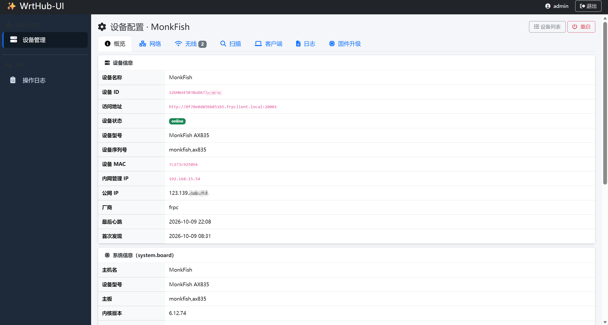
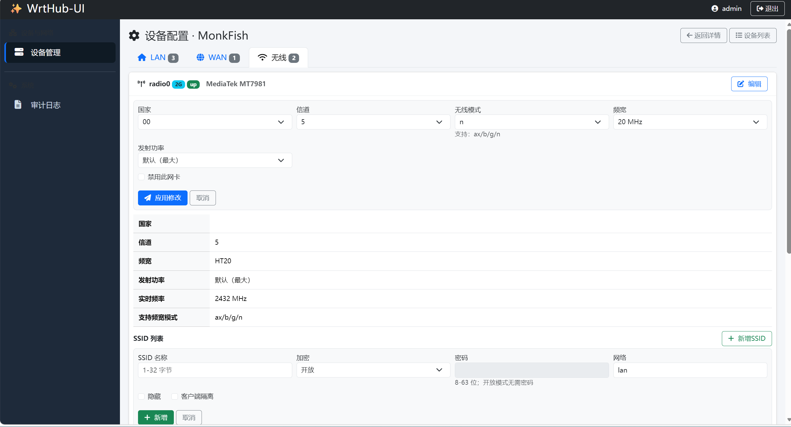
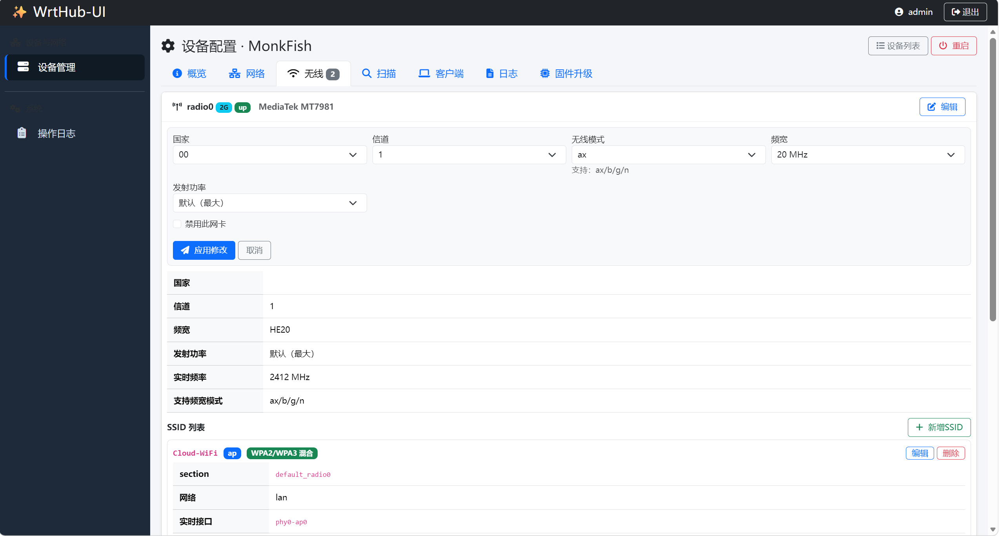
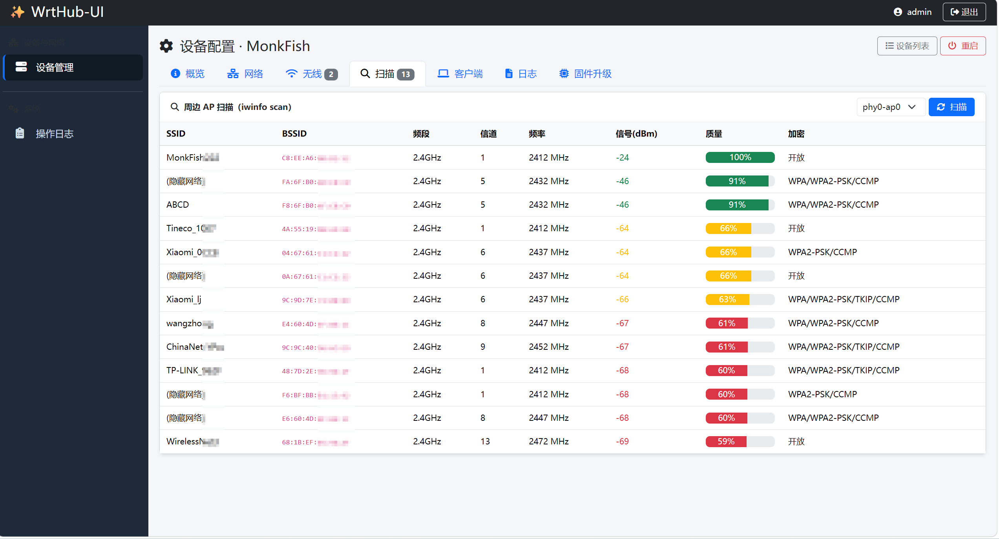
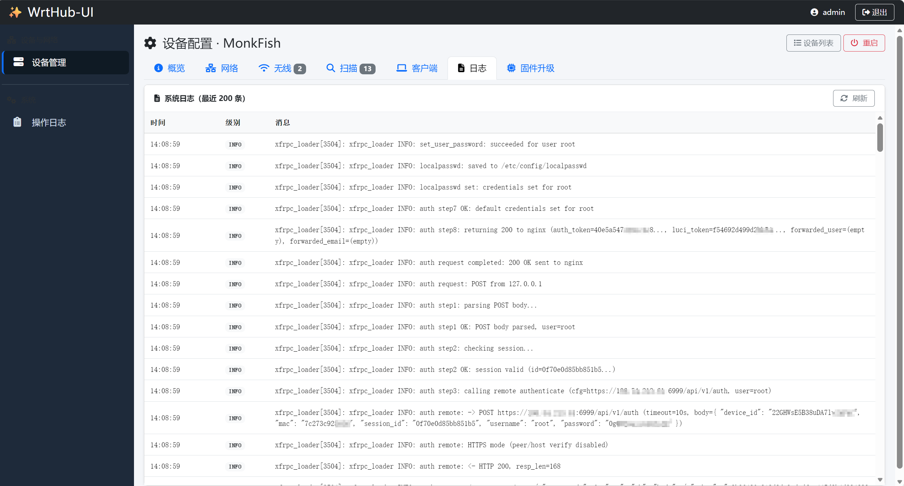
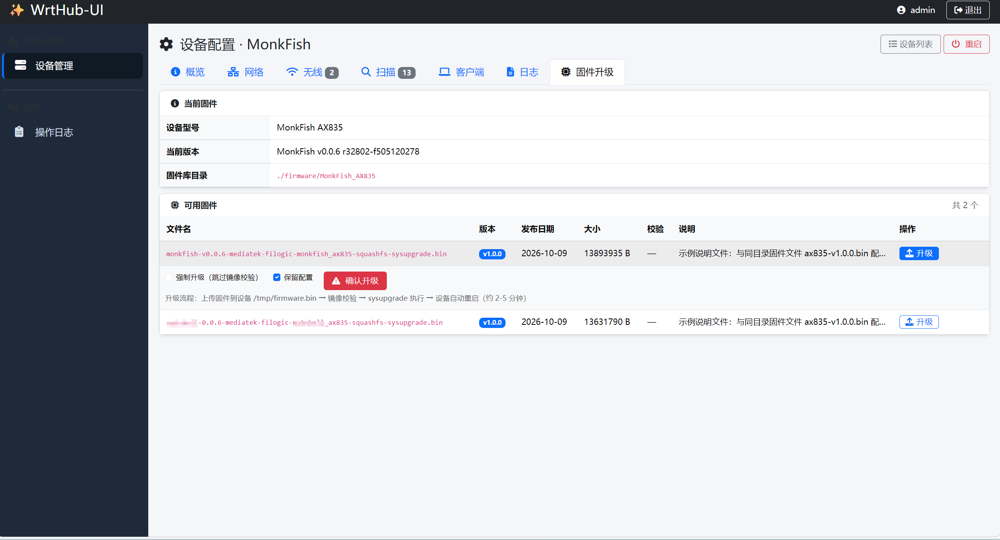
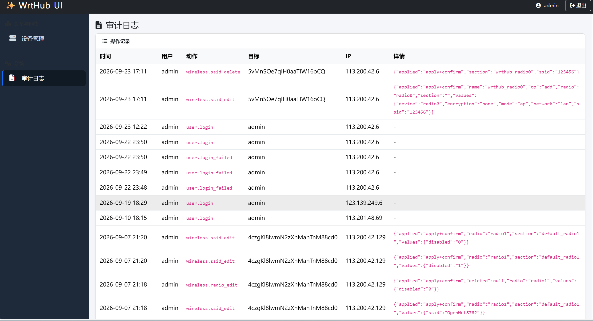

# WrtHub-UI

> OpenWrt 设备集中管理平台 · 无线网络配置与监控
> A centralized management platform for OpenWrt devices — wireless configuration & monitoring


[中文](#中文) · [English](#english)

---

## 中文

### 项目简介

WrtHub-UI 是一套面向海量 OpenWrt 设备的集中管理平台。它通过 **frps_helper** 北向接口获取设备列表与临时凭证，再经 frp 隧道直连设备，以 **UBUS JSON-RPC** 完成设备信息采集、无线网络配置与监控、固件升级等操作。平台自带用户 / 角色 / 权限（RBAC）与操作日志体系，重点能力为**无线网络管理**。

### 界面预览

| 设备概览（设备信息 + 系统信息） | 无线配置（无线网卡参数 / 新增 SSID） |
| :---: | :---: |
|  |  |

| 无线配置（已配置 SSID 列表） | 周边 AP 扫描 |
| :---: | :---: |
|  |  |

| 系统日志 | 固件升级 |
| :---: | :---: |
|  |  |

**操作日志（审计）**



### 核心特性

- **设备管理**：设备列表（分页 / 关键字 / 状态过滤），设备概览（北向字段 + `system.board` 系统信息），网络接口状态（`network.interface` dump）。
- **无线管理**：多无线网卡（radio）识别与参数编辑（国家 / 信道 / 无线模式 / 频宽 / 发射功率 / 启停）；SSID 新增 / 编辑 / 删除 / 隐藏 / 客户端隔离；周边 AP 扫描（`iwinfo.scan`）；接入客户端（`iwinfo.assoclist`）。
- **系统日志**：拉取设备日志，优先使用固件自定义的 `mk.aplogs` 对象，缺失时回退标准 `log` 对象。
- **固件升级**：磁盘固件库按设备型号分目录管理，服务端校验和比对（md5 / sha256）+ cgi-io 上传 + `sysupgrade`，支持保留配置 / 强制升级。
- **用户与权限**：本地登录（bcrypt 密码哈希 + Gin session cookie）、RBAC（`模块:动作` 粒度）、9 个默认权限，`admin` 角色全权。
- **操作日志**：全局中间件统一拦截所有写操作（POST / PUT / DELETE / PATCH）自动落库，敏感字段自动打码，支持多条件筛选与分页。
- **安全约束**：所有写操作走 UBUS；**WAN 口永不提供写配置**、桥模式（无 WAN）下 LAN 只读，防止远程失联；设备 MAC / ifname 白名单校验，避免被用于探测。

### 系统架构

平台与 frps_helper、DNS 泛解析同机部署；WrtHub-UI 只与北向 API 和 frp 隧道通信，不直接暴露设备。

```
                          ┌──────────────── 部署机 (Linux) ────────────────┐
   浏览器 ──HTTP──►  WrtHub-UI (Gin + HTMX, :8080)                        │
                          │                                               │
                          │ 1. 设备列表 / 凭证  ──►  frps_helper 北向 :7443 │
                          │                                               │
                          │ 2. DNS 泛解析 *.frpclient.local               │
                          ▼                                               │
                    OpenWrt 设备（frp 隧道, :20001）                        │
                    POST /auth        登录换 luci_token                    │
                    POST /ubus        JSON-RPC（iwinfo / uci / system）     │
                          └───────────────────────────────────────────────┘
```

调用链概要：`GET /api/v1/devices` 取设备列表 → `GET /api/v1/credentials/{id}` 取临时凭证 → `POST http://{session_id}.frpclient.local:20001/auth` 登录换 `luci_token` → 复用该 token 调用 `POST .../ubus`。登录 token 仅在服务端内存短缓存（默认 5 分钟），不落盘、不进日志、不回传前端。

### 技术栈

| 层 | 选型 |
|----|------|
| Web 框架 | Gin |
| 前端交互 | HTMX（无刷新局部更新） |
| 样式 | Bootstrap 5 + Font Awesome 6（本地化，不依赖 CDN） |
| 设备通信 | `/auth` 登录 + UBUS JSON-RPC（`/ubus`），token 复用 |
| 持久化 | SQLite（纯 Go 驱动，默认）/ PostgreSQL，GORM |
| 认证 | 本地登录（用户名 + bcrypt），预留 CASDOOR |
| 会话 | Gin session（cookie） |
| 模板 | Go `html/template`（文件系统读取） |
| 构建 | Makefile，交叉编译 `GOOS=linux GOARCH=amd64` |

### 快速开始

```bash
# 编译（产出到 ./dist/，含二进制、config.yaml、templates/）
make            # = go vet + go build
make build      # 仅编译
make package    # 打包 dist/wrthub-ui-linux-amd64.tar.gz（解压即用）
make vet        # 仅静态检查
make clean      # 清理 dist/

# 运行
make run        # 编译并从 dist/ 运行
# 或
cd dist && ./wrthub-ui
```

默认监听 `:8080`。首次启动会自动创建数据库 `data/wrthub.db`、默认管理员（`admin` / `admin@123`）与 9 个默认权限，**请登录后立即修改密码并更换 `session_secret`**。

> 模板从文件系统读取（`assets.templates_dir`，默认 `./templates`），部署时需将 `templates/` 目录与二进制一同部署；静态资源优先读取外部 `assets/`，缺失时回退内置 embed。

### 配置说明

配置文件 `config.yaml` 的解析优先级：`-d <目录>` → 环境变量 `WRTHUB_CONFIG` → `/usr/local/etc/wrthub-ui/config.yaml` → 当前目录 `config.yaml`。相对路径（`data/`、`assets/`、`templates/`）均锚定到 config.yaml 所在目录。

| 配置项 | 默认值 | 说明 |
|--------|--------|------|
| `app.log_level` | `info` | 日志级别 |
| `server.addr` | `:8080` | HTTP 监听地址 |
| `server.session_secret` | `change-me` | 会话签名密钥，生产**必须**重置 |
| `frps_helper.base_url` | `https://127.0.0.1:7443` | 北向 API 地址 |
| `frps_helper.tls_insecure` | `true` | 北向自签证书时置 `true` |
| `device_rpc.scheme` / `domain_suffix` / `port` | `http` / `frpclient.local` / `20001` | 设备隧道地址：`{session_id}.{domain_suffix}:{port}` |
| `device_rpc.token_cache_ttl` | `5m` | 登录 token 内存缓存时长 |
| `device_rpc.timeout` | `10s` | 通用调用超时 |
| `device_rpc.upload_timeout` | `30m` | 固件上传专用超时（大文件慢操作） |
| `device_rpc.max_concurrency` | `4` | 单设备并发上限 |
| `auth.mode` | `local` | `local` / `casdoor` |
| `auth.init_username` / `init_password` | `admin` / `admin@123` | 首次启动创建的管理员，仅首次生效 |
| `storage.driver` / `sqlite_path` | `sqlite` / `data/wrthub.db` | 存储驱动与路径 |
| `assets.external_dir` / `templates_dir` | `./assets` / `./templates` | 外部资源目录（优先于内置 embed） |
| `firmware.root` / `max_size_mb` | `./firmware` / `512` | 固件库根目录与单文件大小上限 |

### 权限模型

默认权限码为 `模块:动作` 粒度，`admin` 角色自动获授全部权限并绕过权限校验：

| 权限码 | 说明 | 权限码 | 说明 |
|--------|------|--------|------|
| `device:read` / `device:write` | 查看 / 管理设备 | `role:read` / `role:write` | 查看 / 管理角色 |
| `wireless:read` / `wireless:write` | 查看 / 管理无线 | `audit:read` | 查看审计 |
| `user:read` / `user:write` | 查看 / 管理用户 | | |

### 目录结构

```
WrtHub-UI/
├── cmd/wrthub-ui/main.go     程序入口（配置加载、HTTP 服务、优雅退出）
├── internal/
│   ├── config/               配置加载与默认值
│   ├── logger/               slog 日志
│   ├── store/                GORM 模型、SQLite/PG 初始化、RBAC 与用户
│   ├── auth/                 本地认证 + 会话 + 权限中间件
│   ├── frpsclient/           frps_helper 北向客户端（设备 / 凭证）
│   ├── lucirpc/              /auth 登录 + token 缓存
│   ├── ubusrpc/              UBUS JSON-RPC 数据通道
│   ├── service/              凭证 provider、无线业务
│   ├── firmware/             固件库（磁盘读取 + 校验和校验）
│   ├── render/               html/template 渲染
│   ├── assets/               内置静态资源（go:embed）
│   └── server/               App 装配、路由与各页 handler
├── templates/                Go 模板（外部读取）
│   ├── layout.html
│   └── pages/                设备 / 无线 / 用户 / 审计页
├── tools/                    hashpw 密码哈希、pack 打包
├── config.yaml               运行配置
├── Makefile                  构建入口
└── snapshots/                README 截图
```

### 部署

以 systemd 服务化运行（`/etc/systemd/system/wrthub-ui.service`）：

```ini
[Unit]
Description=WrtHub-UI
After=network-online.target
Wants=network-online.target

[Service]
Type=simple
User=wrthub
Group=wrthub
WorkingDirectory=/opt/wrthub-ui
ExecStart=/opt/wrthub-ui/wrthub-ui
Restart=on-failure
RestartSec=3
LimitNOFILE=65536

[Install]
WantedBy=multi-user.target
```

命令：

```bash
tar -xzf wrthub-ui-linux-amd64.tar.gz -C /opt/wrthub-ui   # 解出 wrthub-ui / config.yaml / templates
sudo systemctl daemon-reload
sudo systemctl enable --now wrthub-ui
sudo journalctl -u wrthub-ui -f                            # 查看日志
```

对外暴露 80 / 443 时建议由 nginx 反向代理到 `127.0.0.1:8080` 并做 TLS 终止。生产部署前请确认 `session_secret`、`init_password` 已更换，且服务以非 root 用户运行。

### 相关文档

随主项目 `Documents/` 目录提供，包括《开发技术文档》《部署手册》《无线配置功能开发文档》《北向接口规范》《UBUS 访问指南》等。

---

## English

### Overview

WrtHub-UI is a centralized management platform for fleets of OpenWrt devices. It retrieves the device list and temporary credentials from the **frps_helper** northbound API, then connects to each device through the frp tunnel and uses **UBUS JSON-RPC** for device information, wireless configuration & monitoring, and firmware upgrades. It ships with its own user / role / permission (RBAC) and operation-log subsystem, with **wireless management** as the flagship capability.

### Screenshots

| Device overview (info + system) | Wireless config (radio params / add SSID) |
| :---: | :---: |
|  |  |

| Wireless config (SSID list) | Nearby AP scan |
| :---: | :---: |
|  |  |

| System log | Firmware upgrade |
| :---: | :---: |
|  |  |

**Operation log (audit)**


### Features

- **Device management** — device list (paging / keyword / status filter), overview (northbound fields + `system.board` system info), network interface status (`network.interface` dump).
- **Wireless management** — detect multiple radios and edit their parameters (country / channel / mode / bandwidth / txpower / enable); add, edit, delete, hide SSIDs and toggle client isolation; scan nearby APs (`iwinfo.scan`); list associated clients (`iwinfo.assoclist`).
- **System log** — pull device logs, preferring the firmware's custom `mk.aplogs` object and falling back to the standard `log` object.
- **Firmware upgrade** — a disk-based firmware library organized by device model, with server-side checksum verification (md5 / sha256), cgi-io upload and `sysupgrade`, supporting keep-config / force upgrade.
- **Users & permissions** — local login (bcrypt + Gin session cookie), RBAC at `module:action` granularity, 9 default permissions, with the `admin` role bypassing all checks.
- **Operation log** — a global middleware intercepts every write request (POST / PUT / DELETE / PATCH) and persists it automatically, masking sensitive fields, with multi-condition filtering and paging.
- **Safety constraints** — all writes go through UBUS; the **WAN interface is never writable** and LAN is read-only in bridge mode (no WAN) to avoid losing remote access; device MAC / ifname whitelist validation prevents probing.

### Architecture

The platform is co-located with frps_helper and DNS wildcard resolution; WrtHub-UI only talks to the northbound API and the frp tunnels, never exposing devices directly.

```
                          ┌──────────────── Host (Linux) ────────────────┐
   Browser ──HTTP──►  WrtHub-UI (Gin + HTMX, :8080)                     │
                          │                                             │
                          │ 1. device list / credentials ─► frps_helper │
                          │                                             │
                          │ 2. DNS wildcard *.frpclient.local           │
                          ▼                                             │
                    OpenWrt device (frp tunnel, :20001)                 │
                    POST /auth        login → luci_token                │
                    POST /ubus        JSON-RPC (iwinfo / uci / system)  │
                          └─────────────────────────────────────────────┘
```

Call chain: `GET /api/v1/devices` → `GET /api/v1/credentials/{id}` → `POST http://{session_id}.frpclient.local:20001/auth` to obtain a `luci_token` → reuse that token for `POST .../ubus`. The token is only cached briefly in server memory (5 min by default); it is never persisted, logged or sent to the browser.

### Tech stack

| Layer | Choice |
|-------|--------|
| Web framework | Gin |
| Frontend interaction | HTMX (partial, no-refresh updates) |
| Styling | Bootstrap 5 + Font Awesome 6 (bundled locally, no CDN) |
| Device communication | `/auth` login + UBUS JSON-RPC (`/ubus`), token reuse |
| Persistence | SQLite (pure-Go driver, default) / PostgreSQL via GORM |
| Authentication | Local login (username + bcrypt), CASDOOR reserved |
| Session | Gin session (cookie) |
| Templates | Go `html/template` (read from filesystem) |
| Build | Makefile, cross-compile `GOOS=linux GOARCH=amd64` |

### Quick start

```bash
# Build (outputs to ./dist/: binary, config.yaml, templates/)
make            # = go vet + go build
make build      # build only
make package    # package dist/wrthub-ui-linux-amd64.tar.gz (extract and run)
make vet        # static checks only
make clean      # clean dist/

# Run
make run        # build and run from dist/
# or
cd dist && ./wrthub-ui
```

It listens on `:8080` by default. On first launch it creates the database `data/wrthub.db`, the default admin (`admin` / `admin@123`) and 9 default permissions — **log in and change the password and `session_secret` immediately**.

> Templates are read from the filesystem (`assets.templates_dir`, default `./templates`), so the `templates/` directory must be deployed alongside the binary. Static assets prefer an external `assets/` directory and fall back to the embedded copy when absent.

### Configuration

`config.yaml` is resolved in this order: `-d <dir>` → env `WRTHUB_CONFIG` → `/usr/local/etc/wrthub-ui/config.yaml` → `./config.yaml`. Relative paths (`data/`, `assets/`, `templates/`) are anchored to the directory containing config.yaml.

| Key | Default | Description |
|-----|---------|-------------|
| `app.log_level` | `info` | Log level |
| `server.addr` | `:8080` | HTTP listen address |
| `server.session_secret` | `change-me` | Session signing key, **must** be reset in production |
| `frps_helper.base_url` | `https://127.0.0.1:7443` | Northbound API URL |
| `frps_helper.tls_insecure` | `true` | Set `true` for self-signed northbound certs |
| `device_rpc.scheme` / `domain_suffix` / `port` | `http` / `frpclient.local` / `20001` | Device tunnel address: `{session_id}.{domain_suffix}:{port}` |
| `device_rpc.token_cache_ttl` | `5m` | Login token in-memory cache TTL |
| `device_rpc.timeout` | `10s` | General call timeout |
| `device_rpc.upload_timeout` | `30m` | Dedicated firmware upload timeout (large, slow operation) |
| `device_rpc.max_concurrency` | `4` | Per-device concurrency limit |
| `auth.mode` | `local` | `local` / `casdoor` |
| `auth.init_username` / `init_password` | `admin` / `admin@123` | Admin created on first launch (first run only) |
| `storage.driver` / `sqlite_path` | `sqlite` / `data/wrthub.db` | Storage driver and path |
| `assets.external_dir` / `templates_dir` | `./assets` / `./templates` | External asset dirs (override the embedded copy) |
| `firmware.root` / `max_size_mb` | `./firmware` / `512` | Firmware library root and per-file size limit |

### Permission model

Permission codes use `module:action` granularity; the `admin` role is granted all of them and bypasses checks:

| Code | Description | Code | Description |
|------|-------------|------|-------------|
| `device:read` / `device:write` | Read / manage devices | `role:read` / `role:write` | Read / manage roles |
| `wireless:read` / `wireless:write` | Read / manage wireless | `audit:read` | Read audit logs |
| `user:read` / `user:write` | Read / manage users | | |

### Project layout

```
WrtHub-UI/
├── cmd/wrthub-ui/main.go     Entry point (config load, HTTP server, graceful shutdown)
├── internal/
│   ├── config/               Config loading and defaults
│   ├── logger/               slog logger
│   ├── store/                GORM models, SQLite/PG init, RBAC and users
│   ├── auth/                 Local auth + session + permission middleware
│   ├── frpsclient/           frps_helper northbound client (devices / credentials)
│   ├── lucirpc/              /auth login + token cache
│   ├── ubusrpc/              UBUS JSON-RPC data channel
│   ├── service/              Credential provider, wireless service
│   ├── firmware/             Firmware library (disk read + checksum)
│   ├── render/               html/template renderer
│   ├── assets/               Embedded static assets (go:embed)
│   └── server/               App wiring, router and page handlers
├── templates/                Go templates (read externally)
│   ├── layout.html
│   └── pages/                Device / wireless / user / audit pages
├── tools/                    hashpw (password hash), pack (packaging)
├── config.yaml               Runtime config
├── Makefile                  Build entry point
└── snapshots/                README screenshots
```

### Deployment

Run as a systemd service (`/etc/systemd/system/wrthub-ui.service`):

```ini
[Unit]
Description=WrtHub-UI
After=network-online.target
Wants=network-online.target

[Service]
Type=simple
User=wrthub
Group=wrthub
WorkingDirectory=/opt/wrthub-ui
ExecStart=/opt/wrthub-ui/wrthub-ui
Restart=on-failure
RestartSec=3
LimitNOFILE=65536

[Install]
WantedBy=multi-user.target
```

```bash
tar -xzf wrthub-ui-linux-amd64.tar.gz -C /opt/wrthub-ui   # extracts wrthub-ui / config.yaml / templates
sudo systemctl daemon-reload
sudo systemctl enable --now wrthub-ui
sudo journalctl -u wrthub-ui -f                            # follow logs
```

To expose 80 / 443, put nginx in front and reverse-proxy to `127.0.0.1:8080` for TLS termination. Before going to production, reset `session_secret` and `init_password`, and run the service as a non-root user.

### Documentation

Provided in the parent project's `Documents/` directory: *Development Technical Document*, *Deployment Manual*, *Wireless Configuration Development Document*, *Northbound API Specification*, *UBUS Access Guide*, and more.