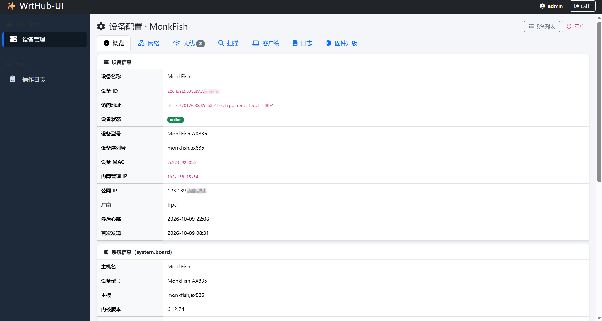
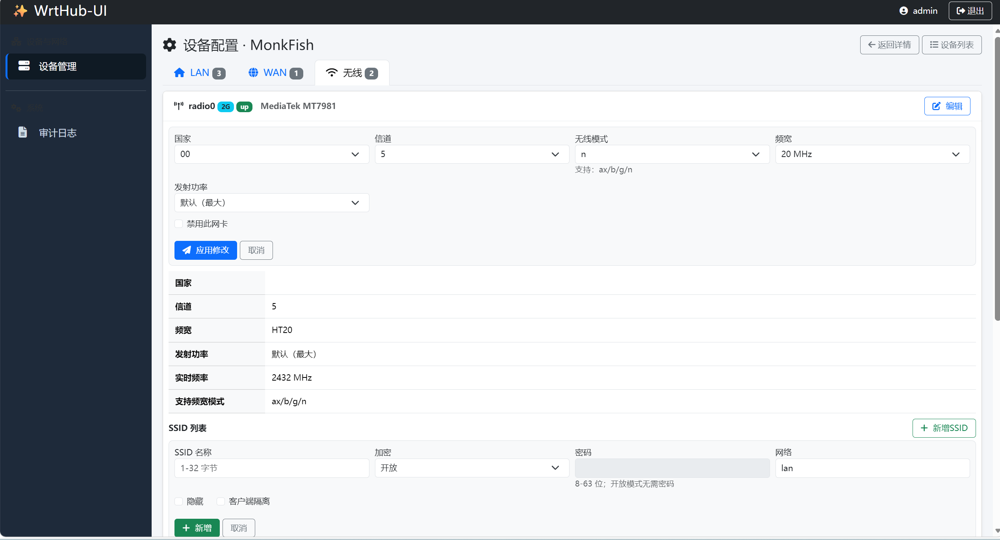
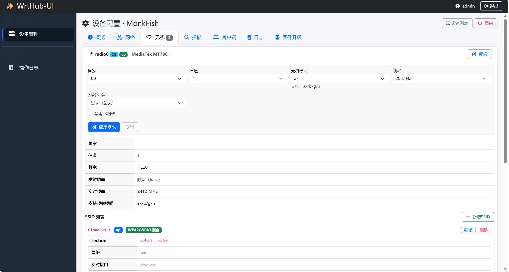
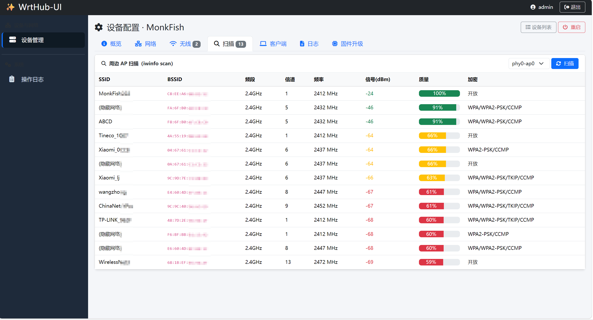
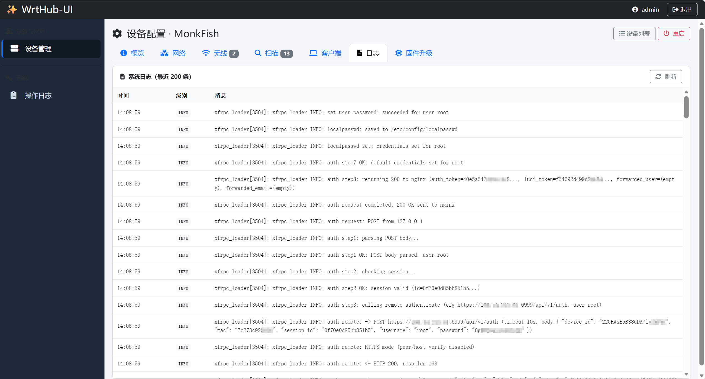
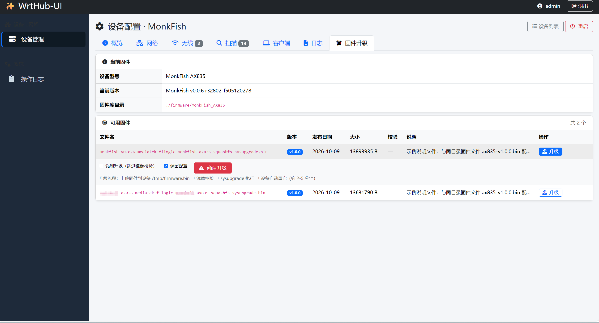
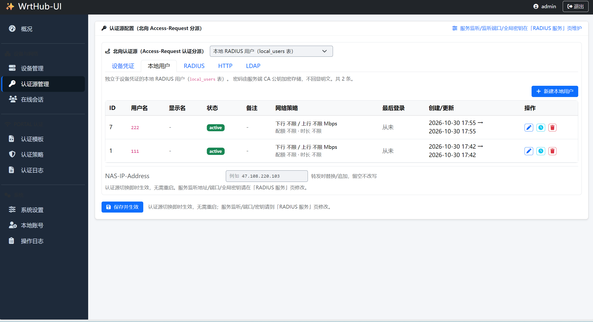
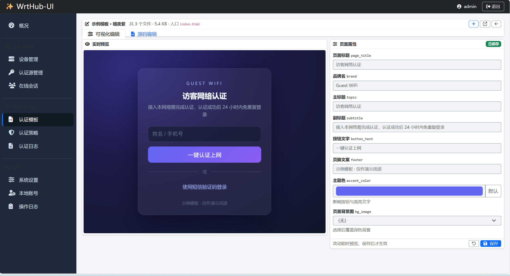
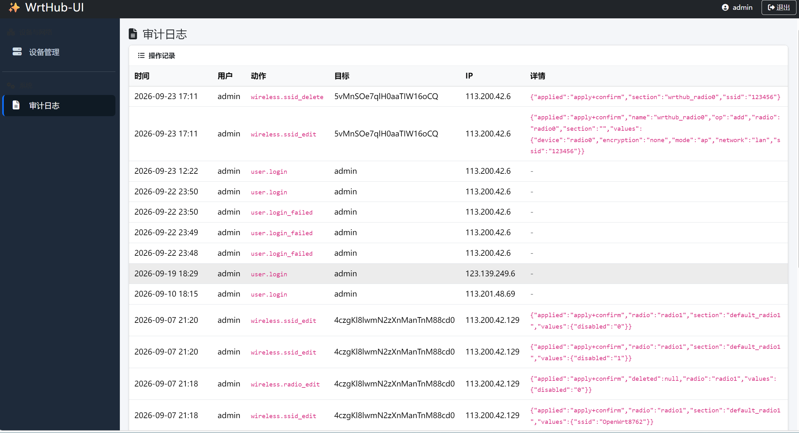

# WrtHub-UI

> OpenWrt 设备集中管理平台 · 无线网络配置与监控 · PORTAL 认证运营
> A centralized management platform for OpenWrt devices — wireless configuration, monitoring & portal operations


[中文](#中文) · [English](#english)

> **项目文档网站：<http://monkfish.cn>**

---

## 中文

### 项目简介

WrtHub-UI 是一套面向海量 OpenWrt 设备的集中管理平台。它通过 **frps_helper** 北向接口获取设备列表与临时凭证，再经 frp 隧道（或直连设备 LAN）访问设备，以 **UBUS JSON-RPC** 完成设备信息采集、无线网络配置与监控、固件升级等操作。平台同时承担 **PORTAL 认证运营**：管理认证模板、认证策略、认证日志，维护北向认证源（本地用户 / RADIUS / HTTP / LDAP），并查看在线会话。自带用户 / 角色 / 权限（RBAC）与操作日志体系。

### 特性一览

- **集中纳管**：一个入口管理全部设备，经 frp 隧道或 LAN 直连，无需逐台暴露管理端口
- **无线管理**：radio 参数调整、SSID 增删改、周边 AP 扫描、接入客户端踢下线
- **认证源管理**：本地用户 / RADIUS / HTTP / LDAP 四选一，支持带宽与在线时长策略
- **PORTAL 运营**：模板可视化编辑与实时预览、认证策略匹配、认证日志查询
- **在线会话**：5 秒自动刷新，可强制下线
- **配置与固件**：配置快照与关键项合规比对、固件库管理与一键升级
- **安全与审计**：17 项 RBAC 权限、全局写操作审计、WAN 口永不可写

### 界面预览

| 设备概览（设备信息 + 系统信息） | 无线配置（无线网卡参数 / 新增 SSID） |
| :---: | :---: |
|  |  |

| 无线配置（已配置 SSID 列表） | 周边 AP 扫描 |
| :---: | :---: |
|  |  |

| 系统日志 | 固件升级 |
| :---: | :---: |
|  |  |

| 认证源管理（北向认证源 / 本地用户） | PORTAL 认证模板（可视化编辑 + 实时预览） |
| :---: | :---: |
|  |  |

**操作日志（审计）**



### 核心特性

- **概况总览**：默认首页汇总设备总数 / 在线 / 离线 / 待审核、在线会话数、本地用户数、RADIUS 运行时状态、今日 PORTAL 认证量、同机服务（frps / frps_helper / portal-server）运行状态，以及最近操作与认证日志。
- **设备管理**：设备列表（分页 / 关键字 / 状态过滤），设备概览（北向字段 + `system.board` 系统信息），网络接口状态（`network.interface` dump）；设备预注册、自动注册开关、删除设备（在线设备拒绝删除）。
- **无线管理**：多无线网卡（radio）识别与参数编辑（国家 / 信道 / 无线模式 / 频宽 / 发射功率 / 启停）；SSID 新增 / 编辑 / 删除 / 隐藏 / 客户端隔离；周边 AP 扫描（`iwinfo.scan`）；接入客户端（`iwinfo.assoclist`）。
- **配置项与配置快照**：按内置关键项清单（`webauthd.*` / `network.lan.*` / `wireless.radio0.*`）读取设备 UCI 并比对基线，标记 `ok` / `drift` / `missing` / `na` / `error`；可采集配置快照、查看详情、下载备份，用于变更前后追溯。
- **认证源管理（北向）**：一次只选一个认证数据源——本地用户（`local_users`，密码经服务端 CA 公钥加密存储）、RADIUS、HTTP、LDAP；本地用户支持增删改查、启停、带宽策略（上 / 下行速率）、在线时长配额与登录日志；可设置 `NAS-IP-Address`，保存即时生效。另在设备详情页维护每设备对接参数与南向认证源切换（写设备 UCI `webauthd`）。
- **在线会话**：记账会话列表（分页 / 关键字查询，5 秒自动刷新），支持强制下线（经隧道调用设备 `webauthd.session/drop_user`）。
- **PORTAL 认证运营**：认证模板上传（zip，白名单校验）/ 复制 / 启停 / 删除 / 在线源码编辑 / 可视化编辑（`schema.json` 声明文案、颜色、图片）/ 实时预览；认证策略按 SSID / AC / APID / IP 前缀 / 时段 / 星期匹配后选用模板；认证日志查询与详情。
- **系统设置**：TAB 组织 PORTAL 设置、RADIUS 服务、证书管理（`ca` / `server-auth` / `https` 三槽位上传、校验、应用热生效、历史版本与回滚、备份恢复）、固件管理（按型号分目录，上传自动生成说明 JSON）。
- **系统日志**：拉取设备日志，优先使用固件自定义的 `mk.aplogs` 对象，缺失时回退标准 `log` 对象。
- **固件升级**：磁盘固件库按设备型号分目录管理，服务端校验和比对（md5 / sha256）+ cgi-io 上传 + `sysupgrade`，支持保留配置 / 强制升级。
- **用户与权限**：本地登录（bcrypt 密码哈希 + Gin session cookie）、RBAC（`模块:动作` 粒度）、17 个默认权限，`admin` 角色全权。
- **操作日志**：全局中间件统一拦截所有写操作（POST / PUT / DELETE / PATCH）自动落库，敏感字段自动打码，支持多条件筛选与分页。
- **安全约束**：所有写操作走 UBUS；**WAN 口永不提供写配置**、桥模式（无 WAN）下 LAN 只读，防止远程失联；设备 MAC / ifname 白名单校验，避免被用于探测；设备登录 token 仅服务端内存缓存，不落盘、不进日志、不回传前端。

### 功能清单

| 菜单 | 路由 | 说明 |
|------|------|------|
| 概况 | `/overview` | 默认首页：设备统计、在线会话、本地用户、RADIUS 运行时、今日 PORTAL 认证、服务运行状态、最近操作与认证日志 |
| 设备管理 | `/devices` | 分页 / 关键字 / 状态过滤；设备详情（北向字段 + `system.board`）；网络接口；配置项；配置快照；重启；固件升级 |
| 认证源管理 | `/auth-source` | 北向认证源（local / radius / http / ldap）配置、本地用户 CRUD 与登录日志、每设备 RADIUS 参数 |
| 在线会话 | `/sessions` | 记账会话列表（分页 / 关键字查询，5 秒自动刷新）、强制下线 |
| 认证模板 | `/portal/templates` | 模板上传 / 复制 / 启停 / 删除、源码与可视化编辑、实时预览 |
| 认证策略 | `/portal/policies` | 认证策略启用 / 停用 / 删除 |
| 认证日志 | `/portal/auth-logs` | PORTAL 认证记录查询与详情 |
| 系统设置 | `/settings` | TAB：PORTAL 设置、RADIUS 服务、证书管理、固件管理 |
| 本地账号 | `/users` | 平台用户 / 角色 / 权限（RBAC） |
| 操作日志 | `/operation-logs` | 全局写操作审计（POST / PUT / DELETE / PATCH 自动落库） |
| 无线管理 | `/devices/:id/wireless` | radio 参数、SSID 增删改、周边扫描、接入客户端、踢下线 |
| 登录 | `/login`、`/logout` | 本地账号 + bcrypt + session cookie |

### 系统架构

平台与 frps_helper、portal-server、DNS 泛解析同机部署；WrtHub-UI 只与北向 API 和 frp 隧道通信，不直接暴露设备。

```
                           ┌──────────────── 部署机 (Linux) ────────────────┐
    浏览器 ──HTTP──►  WrtHub-UI (Gin + HTMX, :8080)                         │
                           │                                                │
                           │ 1. 设备列表 / 凭证 / 状态 ──► frps_helper :7443  │
                           │ 2. portal-server 健康探测 ──► :19090            │
                           │                                                │
                           │ 3. DNS 泛解析 *.frpclient.local                 │
                           ▼                                                │
                     OpenWrt 设备（frp 隧道, :20001）                         │
                     POST /auth        登录换 luci_token                     │
                     POST /ubus        JSON-RPC（iwinfo / uci / system）      │
                           └────────────────────────────────────────────────┘
```

调用链概要：`GET /api/v1/devices` 取设备列表 → `GET /api/v1/credentials/{id}` 取临时凭证 → `POST http://{session_id}.frpclient.local:20001/auth` 登录换 `luci_token` → 复用该 token 调用 `POST .../ubus`（LuCI RPC 失败时以 `/ubus` 兜底）。登录 token 仅在服务端内存短缓存（默认 5 分钟）。

设备访问地址由 `DeviceTargetResolver` 解析：`frpc_mode=on` 走隧道；`frpc_mode=off`（或 auto 下 `ext_ip_address == lan_ip`）判定为直连，改走 `http://{lan_ip}:8765`；北向查询失败时回退隧道地址。

PORTAL 侧：模板是纯静态页面包，WrtHub-UI 负责管理与预览，portal-server 只读同一模板根目录对外提供页面，登录校验发生在设备侧 `webauthd`，云端不参与认证。

### 技术栈

| 层 | 选型 |
|----|------|
| Web 框架 | Gin |
| 前端交互 | HTMX（无刷新局部更新） |
| 样式 | Bootstrap 5 + Font Awesome 6（本地化，不依赖 CDN） |
| 设备通信 | `/auth` 登录 + UBUS JSON-RPC（`/ubus`），token 复用 |
| 持久化 | SQLite（纯 Go 驱动，默认）/ PostgreSQL，GORM |
| 认证 | 本地登录（用户名 + bcrypt），预留 CASDOOR |
| 会话 | Gin session（cookie） |
| 模板 | Go `html/template`（文件系统读取） |
| 构建 | Makefile，交叉编译 `GOOS=linux GOARCH=amd64` |

### 快速开始

```bash
# 编译（产出到 ./dist/，含二进制、config.yaml、templates/）
make            # = go vet + go build
make build      # 仅编译
make package    # 打包 dist/wrthub-ui-linux-amd64.tar.gz（解压即用）
make vet        # 仅静态检查
make clean      # 清理 dist/

# 运行
make run        # 编译并从 dist/ 运行
# 或
cd dist && ./wrthub-ui
```

默认监听 `:8080`。首次启动会自动创建数据库 `data/wrthub.db`、默认管理员（`admin` / `admin@123`）、17 个默认权限，并播种内置 PORTAL 示例模板，**请登录后立即修改密码并更换 `session_secret`**。

> 模板从文件系统读取（`assets.templates_dir`，默认 `./templates`），部署时需将 `templates/` 目录与二进制一同部署；静态资源优先读取外部 `assets/`，缺失时回退内置 embed。

### 配置说明

配置文件 `config.yaml` 的解析优先级：`-d <目录>` → 环境变量 `WRTHUB_CONFIG` → `/usr/local/etc/wrthub-ui/config.yaml` → 当前目录 `config.yaml`。相对路径（`data/`、`assets/`、`templates/`）均锚定到 config.yaml 所在目录。

| 配置项 | 默认值 | 说明 |
|--------|--------|------|
| `app.log_level` | `info` | 日志级别 |
| `server.addr` | `:8080` | HTTP 监听地址 |
| `server.session_secret` | `change-me` | 会话签名密钥，生产**必须**重置 |
| `frps_helper.base_url` | `https://127.0.0.1:7443` | 北向 API 地址 |
| `frps_helper.tls_insecure` | `true` | 北向自签证书时置 `true` |
| `frps_helper.credential_query` | `true` | 是否按需查询明文凭证（与 frps_helper 对应开关配合） |
| `frps_helper.request_timeout` | `10s` | 北向请求超时 |
| `device_rpc.scheme` / `domain_suffix` / `port` | `http` / `frpclient.local` / `20001` | 设备隧道地址：`{session_id}.{domain_suffix}:{port}` |
| `device_rpc.direct_port` | `8765` | 直连模式下设备 nginx 端口 |
| `device_rpc.auth_path` | `/auth` | 设备登录路径 |
| `device_rpc.rpc_path_prefix` | `/cgi-bin/luci/rpc` | LuCI RPC 路径前缀 |
| `device_rpc.ubus_path` | `/ubus` | UBUS JSON-RPC 端点（LuCI RPC 失败时兜底） |
| `device_rpc.token_cache_ttl` | `5m` | 登录 token 内存缓存时长 |
| `device_rpc.timeout` | `10s` | 通用调用超时 |
| `device_rpc.upload_timeout` | `30m` | 固件上传专用超时（大文件慢操作） |
| `device_rpc.max_concurrency` | `4` | 单设备并发上限 |
| `auth.mode` | `local` | `local` / `casdoor` |
| `auth.init_username` / `init_password` | `admin` / `admin@123` | 首次启动创建的管理员，仅首次生效 |
| `storage.driver` / `sqlite_path` | `sqlite` / `data/wrthub.db` | 存储驱动与路径 |
| `storage.postgres_dsn` | 空 | PostgreSQL DSN（`driver=postgres` 时） |
| `assets.external_dir` / `templates_dir` | `./assets` / `./templates` | 外部资源目录（优先于内置 embed） |
| `firmware.root` / `max_size_mb` | `./firmware` / `512` | 固件库根目录与单文件大小上限 |
| `portal.template_root` | `./data/portal-templates` | PORTAL 模板根目录（与 portal-server 共用布局） |
| `services.portal_server.base_url` | `http://127.0.0.1:19090` | 概况页 portal-server 健康探测地址 |
| `services.portal_server.timeout` | `3s` | 探测超时 |

### 权限模型

默认权限码为 `模块:动作` 粒度，`admin` 角色自动获授全部权限并绕过权限校验：

| 权限码 | 说明 | 权限码 | 说明 |
|--------|------|--------|------|
| `device:read` / `device:write` | 查看 / 管理设备 | `user:read` / `user:write` | 查看 / 管理平台用户 |
| `wireless:read` / `wireless:write` | 查看 / 管理无线 | `role:read` / `role:write` | 查看 / 管理角色 |
| `portal:read` / `portal:write` | 查看 / 管理 PORTAL | `audit:read` | 查看操作日志 |
| `setting:read` / `setting:write` | 查看 / 修改系统设置 | `cert:read` / `cert:write` | 查看 / 管理证书 |
| `firmware:read` / `firmware:write` | 查看 / 管理固件库 | | |

### 数据库表（GORM）

`users`、`roles`、`permissions`、`user_roles`、`role_permissions`、`user_tenants`、`audit_logs`、`portal_templates`、`portal_policies`、`portal_auth_logs`、`settings`。

### 主要路由

| 方法 | 路径 | 用途 / 权限 |
|------|------|-------------|
| GET | `/login`、`POST /login`、`POST /logout` | 登录 / 登出（公开） |
| GET | `/healthz` | 健康检查，返回 `{"status":"ok"}`（公开） |
| GET | `/overview` | 概况（`device:read`） |
| GET | `/devices`、`/devices/:id`、`/devices/:id/config` | 设备列表 / 详情 / 配置项（`device:read`） |
| GET | `/devices/:id/wireless` | 无线管理（`wireless:read`） |
| GET / POST | `/devices/:id/config/snapshots[...]` | 配置快照列表 / 详情 / 下载（read）、采集 / 删除（`device:write`） |
| POST | `/devices/:id/config/reboot`、`/firmware/upgrade` | 重启 / 固件升级（`device:write`） |
| POST | `/devices/:id/config/wireless/radio`、`/ssid`、`/ssid/delete` | 无线写操作（`wireless:write`） |
| GET / POST | `/auth-source` | 认证源页面（read）/ 保存（`device:write`） |
| POST | `/auth-source/device/:id` | 设备南向认证源切换（`device:write`） |
| GET | `/sessions`、`/sessions/data` | 在线会话（`device:read`） |
| POST | `/sessions/drop` | 强制下线（`device:write`） |
| GET / POST | `/portal/templates`、`/portal/policies`、`/portal/auth-logs` | PORTAL 页面（`portal:read`）/ 变更（`portal:write`） |
| GET / POST | `/settings` | 系统设置（`setting:read` / `setting:write`） |
| GET / POST | `/users[...]` | 平台用户管理（`user:read` / `user:write`） |
| GET | `/operation-logs` | 操作日志（`audit:read`） |

浏览器侧 JSON API（均由后端代理到 frps_helper 北向接口）：

| 方法 | 路径 | 说明 |
|------|------|------|
| GET / POST / PUT / DELETE | `/auth-source/api/local-users[/:id]` | 本地用户增删改查 |
| GET | `/auth-source/api/local-users/:id/login-logs` | 本地用户登录日志 |
| GET / POST | `/certificates/api/purposes/:purpose[/validate|/versions|/apply|/generate|/rollback]` | 证书槽位详情、校验、历史版本、应用与生成 |
| GET / DELETE | `/certificates/api/backups[/:id]`、`POST /certificates/api/backups/:id/restore` | 证书备份列表 / 删除 / 恢复 |
| GET / POST | `/settings/firmware/models`、`/settings/firmware/download`、`/upload`、`/notes`、`/delete` | 固件库型号、下载与维护 |

### 目录结构

```
WrtHub-UI/
├── cmd/wrthub-ui/main.go     程序入口（配置加载、HTTP 服务、优雅退出）
├── internal/
│   ├── config/               配置加载与默认值
│   ├── logger/               slog 日志
│   ├── store/                GORM 模型、SQLite/PG 初始化、RBAC 与用户
│   ├── auth/                 本地认证 + 会话 + 权限中间件
│   ├── frpsclient/           frps_helper 北向客户端（设备 / 凭证 / 证书 / 状态）
│   ├── lucirpc/              /auth 登录 + token 缓存
│   ├── ubusrpc/              UBUS JSON-RPC 数据通道
│   ├── service/              凭证 provider、无线业务、设备地址解析（隧道 / 直连）
│   ├── configmgr/            配置项关键项定义、快照与合规比对
│   ├── firmware/             固件库（磁盘读取 + 校验和校验）
│   ├── portal/               PORTAL 模板 schema 校验与内置示例播种
│   ├── render/               html/template 渲染
│   ├── assets/               内置静态资源（go:embed）
│   └── server/               App 装配、路由与各页 handler
├── templates/                Go 模板（外部读取）
│   ├── layout.html
│   └── pages/                概况 / 设备 / 无线 / 认证源 / 会话 / PORTAL / 设置 / 用户 / 审计页
├── data/portal-templates/    PORTAL 模板（example-blue / example-dark / wind）
├── tools/                    hashpw 密码哈希、pack 打包
├── config.yaml               运行配置
├── Makefile                  构建入口
└── snapshots/                README 截图
```

### 部署

以 systemd 服务化运行（`/etc/systemd/system/wrthub-ui.service`）：

```ini
[Unit]
Description=WrtHub-UI
After=network-online.target
Wants=network-online.target

[Service]
Type=simple
User=wrthub
Group=wrthub
WorkingDirectory=/opt/wrthub-ui
ExecStart=/opt/wrthub-ui/wrthub-ui
Restart=on-failure
RestartSec=3
LimitNOFILE=65536

[Install]
WantedBy=multi-user.target
```

命令：

```bash
tar -xzf wrthub-ui-linux-amd64.tar.gz -C /opt/wrthub-ui   # 解出 wrthub-ui / config.yaml / templates
sudo systemctl daemon-reload
sudo systemctl enable --now wrthub-ui
sudo journalctl -u wrthub-ui -f                            # 查看日志
```

生产由 `installer` 安装到 `/opt/monkfish/wrthub-ui`，服务 `wrthub-ui.service` 依赖 `frps_helper.service`。对外暴露 80 / 443 时建议由 nginx 反向代理到 `127.0.0.1:8080` 并做 TLS 终止。生产部署前请确认 `session_secret`、`init_password` 已更换，且服务以非 root 用户运行。

### 相关文档

随主项目 `Documents/` 目录提供，包括《开发技术文档》《需求》《部署手册》《无线配置功能开发文档》《PORTAL 模板结构与工作原理》《北向接口规范》《南向接口规范》《UBUS 访问指南》等。更多内容见项目文档网站 <http://monkfish.cn>。

---

## English

### Overview

WrtHub-UI is a centralized management platform for fleets of OpenWrt devices. It retrieves the device list and temporary credentials from the **frps_helper** northbound API, then reaches each device through the frp tunnel (or directly over its LAN) and uses **UBUS JSON-RPC** for device information, wireless configuration & monitoring, and firmware upgrades. It also covers **portal operations**: authentication templates, policies and auth logs, northbound auth sources (local users / RADIUS / HTTP / LDAP), and live sessions. It ships with its own user / role / permission (RBAC) and operation-log subsystem.

> **Project documentation site: <http://monkfish.cn>**

### Highlights

- **One console for the whole fleet** — reach every device over the frp tunnel or directly via its LAN; no management port exposed per device
- **Wireless management** — tune radio parameters, add / edit / delete SSIDs, scan nearby APs, kick associated clients
- **Auth sources** — choose one of local users / RADIUS / HTTP / LDAP, with bandwidth and online-time policies
- **Portal operations** — visual template editing with live preview, policy matching, auth-log search
- **Live sessions** — auto-refresh every 5 s with forced logout
- **Configuration & firmware** — config snapshots with key-item compliance checks, firmware library and one-click upgrade
- **Security & audit** — 17 RBAC permissions, global write-operation audit, WAN interface never writable

### Screenshots

| Device overview (info + system) | Wireless config (radio params / add SSID) |
| :---: | :---: |
|  |  |

| Wireless config (SSID list) | Nearby AP scan |
| :---: | :---: |
|  |  |

| System log | Firmware upgrade |
| :---: | :---: |
|  |  |

| Auth source management (northbound sources / local users) | Portal templates (visual editing + live preview) |
| :---: | :---: |
|  |  |

**Operation log (audit)**


### Features

- **Overview dashboard** — default home page: device totals (online / offline / pending), active sessions, local users, RADIUS runtime, today's portal authentications, co-located service health (frps / frps_helper / portal-server), and recent audit & auth logs.
- **Device management** — device list (paging / keyword / status filter), overview (northbound fields + `system.board` system info), network interface status (`network.interface` dump); pre-registration, auto-registration toggle and device deletion (online devices are rejected).
- **Wireless management** — detect multiple radios and edit their parameters (country / channel / mode / bandwidth / txpower / enable); add, edit, delete, hide SSIDs and toggle client isolation; scan nearby APs (`iwinfo.scan`); list associated clients (`iwinfo.assoclist`).
- **Config items & snapshots** — read device UCI against a built-in key-item checklist (`webauthd.*` / `network.lan.*` / `wireless.radio0.*`) and flag `ok` / `drift` / `missing` / `na` / `error`; capture config snapshots, inspect details and download them for change traceability.
- **Auth source management (northbound)** — pick exactly one authentication data source: local users (`local_users`, passwords encrypted with the server CA public key), RADIUS, HTTP or LDAP. Local users support CRUD, enable/disable, bandwidth policy (up/down rate), online-time quota and login logs; `NAS-IP-Address` is configurable and takes effect immediately. Per-device RADIUS parameters and the southbound auth-source switch (writing device UCI `webauthd`) live on the device detail page.
- **Live sessions** — accounting session list (paging / keyword search, auto-refresh every 5 s) with forced logout via `webauthd.session/drop_user` over the tunnel.
- **Portal operations** — template upload (zip with whitelist validation) / fork / enable / delete, online source editing, visual editing driven by `schema.json` (copy, colors, images) with live preview; policies that select a template by SSID / AC / APID / IP prefix / time window / weekday; auth-log search and detail.
- **System settings** — tabs for Portal settings, RADIUS service, certificate management (`ca` / `server-auth` / `https` slots: upload, validate, hot apply, versions & rollback, backup restore) and firmware management (per-model directories, notes JSON generated on upload).
- **System log** — pull device logs, preferring the firmware's custom `mk.aplogs` object and falling back to the standard `log` object.
- **Firmware upgrade** — a disk-based firmware library organized by device model, with server-side checksum verification (md5 / sha256), cgi-io upload and `sysupgrade`, supporting keep-config / force upgrade.
- **Users & permissions** — local login (bcrypt + Gin session cookie), RBAC at `module:action` granularity, 17 default permissions, with the `admin` role bypassing all checks.
- **Operation log** — a global middleware intercepts every write request (POST / PUT / DELETE / PATCH) and persists it automatically, masking sensitive fields, with multi-condition filtering and paging.
- **Safety constraints** — all writes go through UBUS; the **WAN interface is never writable** and LAN is read-only in bridge mode (no WAN) to avoid losing remote access; device MAC / ifname whitelist validation prevents probing; device login tokens are cached in server memory only — never persisted, logged or sent to the browser.

### Screens & routes

| Menu | Route | Description |
|------|-------|-------------|
| Overview | `/overview` | Default home: device stats, sessions, local users, RADIUS, portal auths, service health, recent logs |
| Devices | `/devices` | Paging / keyword / status filter; detail, interfaces, config items, snapshots, reboot, firmware upgrade |
| Auth sources | `/auth-source` | Northbound source (local / radius / http / ldap), local users CRUD + login logs, per-device RADIUS |
| Sessions | `/sessions` | Accounting sessions (paging / keyword search, 5 s auto-refresh), forced logout |
| Portal templates | `/portal/templates` | Upload / fork / toggle / delete, source & visual editing, live preview |
| Portal policies | `/portal/policies` | Enable / disable / delete policies |
| Portal auth logs | `/portal/auth-logs` | Portal authentication records and details |
| Settings | `/settings` | Tabs: Portal, RADIUS service, certificates, firmware |
| Platform users | `/users` | Users / roles / permissions (RBAC) |
| Operation logs | `/operation-logs` | Global write-operation audit |
| Wireless | `/devices/:id/wireless` | Radio params, SSID CRUD, AP scan, clients, kick |
| Login | `/login`, `/logout` | Local account + bcrypt + session cookie |

### Architecture

The platform is co-located with frps_helper, portal-server and DNS wildcard resolution; WrtHub-UI only talks to the northbound API and the frp tunnels, never exposing devices directly.

```
                           ┌──────────────── Host (Linux) ────────────────┐
    Browser ──HTTP──►  WrtHub-UI (Gin + HTMX, :8080)                      │
                           │                                             │
                           │ 1. device list / credentials / status ─► :7443 │
                           │ 2. portal-server health probe ─► :19090     │
                           │                                             │
                           │ 3. DNS wildcard *.frpclient.local           │
                           ▼                                             │
                     OpenWrt device (frp tunnel, :20001)                 │
                     POST /auth        login → luci_token                │
                     POST /ubus        JSON-RPC (iwinfo / uci / system)  │
                           └─────────────────────────────────────────────┘
```

Call chain: `GET /api/v1/devices` → `GET /api/v1/credentials/{id}` → `POST http://{session_id}.frpclient.local:20001/auth` to obtain a `luci_token` → reuse that token for `POST .../ubus` (falling back to `/ubus` when LuCI RPC fails). The token is only cached briefly in server memory (5 min by default).

Device addresses are resolved by `DeviceTargetResolver`: `frpc_mode=on` uses the tunnel; `frpc_mode=off` (or auto with `ext_ip_address == lan_ip`) means direct mode over `http://{lan_ip}:8765`; on northbound failure it falls back to the tunnel.

Portal side: templates are purely static packages. WrtHub-UI manages and previews them, portal-server serves the same template root read-only, and authentication is performed on-device by `webauthd` — the cloud never validates credentials.

### Tech stack

| Layer | Choice |
|-------|--------|
| Web framework | Gin |
| Frontend interaction | HTMX (partial, no-refresh updates) |
| Styling | Bootstrap 5 + Font Awesome 6 (bundled locally, no CDN) |
| Device communication | `/auth` login + UBUS JSON-RPC (`/ubus`), token reuse |
| Persistence | SQLite (pure-Go driver, default) / PostgreSQL via GORM |
| Authentication | Local login (username + bcrypt), CASDOOR reserved |
| Session | Gin session (cookie) |
| Templates | Go `html/template` (read from filesystem) |
| Build | Makefile, cross-compile `GOOS=linux GOARCH=amd64` |

### Quick start

```bash
# Build (outputs to ./dist/: binary, config.yaml, templates/)
make            # = go vet + go build
make build      # build only
make package    # package dist/wrthub-ui-linux-amd64.tar.gz (extract and run)
make vet        # static checks only
make clean      # clean dist/

# Run
make run        # build and run from dist/
# or
cd dist && ./wrthub-ui
```

It listens on `:8080` by default. On first launch it creates the database `data/wrthub.db`, the default admin (`admin` / `admin@123`), 17 default permissions and seeds the built-in portal templates — **log in and change the password and `session_secret` immediately**.

> Templates are read from the filesystem (`assets.templates_dir`, default `./templates`), so the `templates/` directory must be deployed alongside the binary. Static assets prefer an external `assets/` directory and fall back to the embedded copy when absent.

### Configuration

`config.yaml` is resolved in this order: `-d <dir>` → env `WRTHUB_CONFIG` → `/usr/local/etc/wrthub-ui/config.yaml` → `./config.yaml`. Relative paths (`data/`, `assets/`, `templates/`) are anchored to the directory containing config.yaml.

| Key | Default | Description |
|-----|---------|-------------|
| `app.log_level` | `info` | Log level |
| `server.addr` | `:8080` | HTTP listen address |
| `server.session_secret` | `change-me` | Session signing key, **must** be reset in production |
| `frps_helper.base_url` | `https://127.0.0.1:7443` | Northbound API URL |
| `frps_helper.tls_insecure` | `true` | Set `true` for self-signed northbound certs |
| `frps_helper.credential_query` | `true` | Query plaintext credentials on demand |
| `frps_helper.request_timeout` | `10s` | Northbound request timeout |
| `device_rpc.scheme` / `domain_suffix` / `port` | `http` / `frpclient.local` / `20001` | Device tunnel address: `{session_id}.{domain_suffix}:{port}` |
| `device_rpc.direct_port` | `8765` | Device nginx port in direct mode |
| `device_rpc.auth_path` | `/auth` | Device login path |
| `device_rpc.rpc_path_prefix` | `/cgi-bin/luci/rpc` | LuCI RPC path prefix |
| `device_rpc.ubus_path` | `/ubus` | UBUS JSON-RPC endpoint (fallback) |
| `device_rpc.token_cache_ttl` | `5m` | Login token in-memory cache TTL |
| `device_rpc.timeout` | `10s` | General call timeout |
| `device_rpc.upload_timeout` | `30m` | Dedicated firmware upload timeout |
| `device_rpc.max_concurrency` | `4` | Per-device concurrency limit |
| `auth.mode` | `local` | `local` / `casdoor` |
| `auth.init_username` / `init_password` | `admin` / `admin@123` | Admin created on first launch (first run only) |
| `storage.driver` / `sqlite_path` | `sqlite` / `data/wrthub.db` | Storage driver and path |
| `storage.postgres_dsn` | empty | PostgreSQL DSN (when `driver=postgres`) |
| `assets.external_dir` / `templates_dir` | `./assets` / `./templates` | External asset dirs (override the embedded copy) |
| `firmware.root` / `max_size_mb` | `./firmware` / `512` | Firmware library root and per-file size limit |
| `portal.template_root` | `./data/portal-templates` | Portal template root (shared layout with portal-server) |
| `services.portal_server.base_url` | `http://127.0.0.1:19090` | portal-server health probe URL |
| `services.portal_server.timeout` | `3s` | Probe timeout |

### Permission model

Permission codes use `module:action` granularity; the `admin` role is granted all of them and bypasses checks:

| Code | Description | Code | Description |
|------|-------------|------|-------------|
| `device:read` / `device:write` | Read / manage devices | `user:read` / `user:write` | Read / manage platform users |
| `wireless:read` / `wireless:write` | Read / manage wireless | `role:read` / `role:write` | Read / manage roles |
| `portal:read` / `portal:write` | Read / manage portal | `audit:read` | Read operation logs |
| `setting:read` / `setting:write` | Read / modify settings | `cert:read` / `cert:write` | Read / manage certificates |
| `firmware:read` / `firmware:write` | Read / manage firmware | | |

### Database tables (GORM)

`users`, `roles`, `permissions`, `user_roles`, `role_permissions`, `user_tenants`, `audit_logs`, `portal_templates`, `portal_policies`, `portal_auth_logs`, `settings`.

### Project layout

```
WrtHub-UI/
├── cmd/wrthub-ui/main.go     Entry point (config load, HTTP server, graceful shutdown)
├── internal/
│   ├── config/               Config loading and defaults
│   ├── logger/               slog logger
│   ├── store/                GORM models, SQLite/PG init, RBAC and users
│   ├── auth/                 Local auth + session + permission middleware
│   ├── frpsclient/           frps_helper northbound client (devices / credentials / certs / status)
│   ├── lucirpc/              /auth login + token cache
│   ├── ubusrpc/              UBUS JSON-RPC data channel
│   ├── service/              Credential provider, wireless service, device target resolver
│   ├── configmgr/            Key-item definitions, snapshots and compliance checks
│   ├── firmware/             Firmware library (disk read + checksum)
│   ├── portal/               Portal schema validation and built-in template seeding
│   ├── render/               html/template renderer
│   ├── assets/               Embedded static assets (go:embed)
│   └── server/               App wiring, router and page handlers
├── templates/                Go templates (read externally)
│   ├── layout.html
│   └── pages/                Overview / devices / wireless / auth sources / sessions / portal / settings / users / audit
├── data/portal-templates/    Portal templates (example-blue / example-dark / wind)
├── tools/                    hashpw (password hash), pack (packaging)
├── config.yaml               Runtime config
├── Makefile                  Build entry point
└── snapshots/                README screenshots
```

### Deployment

Run as a systemd service (`/etc/systemd/system/wrthub-ui.service`):

```ini
[Unit]
Description=WrtHub-UI
After=network-online.target
Wants=network-online.target

[Service]
Type=simple
User=wrthub
Group=wrthub
WorkingDirectory=/opt/wrthub-ui
ExecStart=/opt/wrthub-ui/wrthub-ui
Restart=on-failure
RestartSec=3
LimitNOFILE=65536

[Install]
WantedBy=multi-user.target
```

```bash
tar -xzf wrthub-ui-linux-amd64.tar.gz -C /opt/wrthub-ui   # extracts wrthub-ui / config.yaml / templates
sudo systemctl daemon-reload
sudo systemctl enable --now wrthub-ui
sudo journalctl -u wrthub-ui -f                            # follow logs
```

In production the `installer` deploys to `/opt/monkfish/wrthub-ui` and the unit depends on `frps_helper.service`. To expose 80 / 443, put nginx in front and reverse-proxy to `127.0.0.1:8080` for TLS termination. Before going to production, reset `session_secret` and `init_password`, and run the service as a non-root user.

### Documentation

Provided in the parent project's `Documents/` directory: *Development Technical Document*, *Requirements*, *Deployment Manual*, *Wireless Configuration Development Document*, *Portal Template Structure & Principles*, *Northbound API Specification*, *Southbound API Specification*, *UBUS Access Guide*, and more. See also the documentation site <http://monkfish.cn>.
